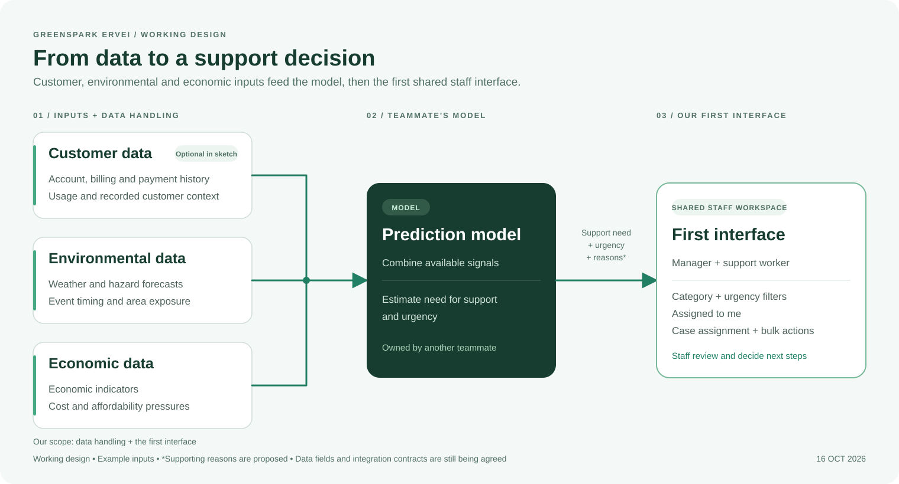
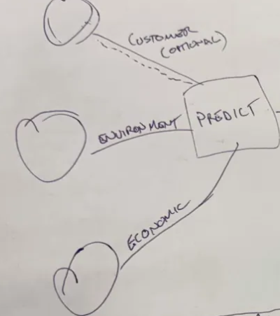

# GreenSpark Ervei

**Challenge 3 — Essential Services Risk of Vulnerability: Early Warning and Intervention Tool.**

Help essential-service teams identify customers who may need support, understand the signals behind a flag, and decide the next step.

## Current stage

The current focus is **planning the first interface and preparing clearly labelled synthetic test data**. The planned stack is React + TypeScript + Vite for the interface and Node.js + TypeScript + Express for the API. Managers and support workers share the same interface with role-appropriate actions.

The approved direction as of **16 October 2026** is the bright green/mint theme and the existing case-queue workflow, including the compact right-side overview. Another teammate owns the prediction model, and another owns full individual cards/profiles.

- [Scope, approved recommendations and five implementation milestones](docs/implementation-plan.md)
- [Proposed data/API/model/profile contract](docs/data-contract.md)
- [Workflow contract: assignment, bulk actions, versioning, Undo](docs/workflow-contract.md)
- [Build progress by milestone](docs/progress.md)
- [100-person synthetic development fixture](data/synthetic/case-queue.v1.json)
- [Test-data instructions and limitations](data/synthetic/README.md)
- [Clickable workflow, selected theme and overview references](docs/design/README.md)

The React application and Node API have not been built yet. The contracts are proposals to agree with the model and profile teammates.

## Start from milestone 1

1. Read [the implementation plan](docs/implementation-plan.md), then [the data contract](docs/data-contract.md).
2. Inspect [the design references](docs/design/README.md). Open `docs/design/workflow-reference.html` in a browser to try the approved interactions; the selected green image defines the visual direction.
3. Run `node scripts/generate-synthetic-cases.mjs --check` from the repository root. This checks the existing 100-person fixture without npm packages, a backend or source-data downloads.
4. Review the proposed person/model integration boundaries, then build milestones 2-5. External model/profile work can remain behind the documented mock adapters while this queue is implemented.

The original preview's illustrative categories and counts are superseded by the current plan and JSON catalogs. The new app should use the versioned synthetic fixture, not the preview's embedded example cases.

## Architecture at a glance

**Customer data + environmental data + economic data → prediction model → first interface.**

| Part | Current understanding |
| --- | --- |
| Customer data | Marked optional in the sketch. Example inputs include available account, billing, payment, usage and explicitly recorded customer information. |
| Environmental data | Weather and hazard signals, including forecast event timing and exposure. Exact feeds remain to be selected. |
| Economic data | Economic indicators and cost or affordability pressures. Exact sources and fields remain to be selected. |
| Data handling — our scope | Prepare the available inputs and connect model results to the records shown in the interface. |
| Prediction model — teammate's scope | Combine the available signals and return useful predictions such as need for support and urgency. The model implementation belongs to another teammate. |
| First interface — our scope | Turn those results into a filterable case list that managers and support workers can review and act on. |

The three input groups come from the sketch. The example fields above are illustrative rather than an agreed schema.

## First interface

The first screen is a shared staff workspace with a case list, a filter panel on the left, and bulk actions for selected cases.

| Capability | Intended behaviour |
| --- | --- |
| Support-area filters | Financial pressure; heating, cooling and home comfort; health-related energy needs. Expand each umbrella into the approved source-supported circumstances. |
| Urgency and support-need filters | Use model outputs to help staff prioritise cases. Exact labels and thresholds are still to be agreed. |
| Assigned to me | Show cases assigned to the signed-in support worker. Assignment comes from the case workflow. |
| Manager assignment | Let managers allocate cases to support workers within the shared interface. |
| Bulk actions | Single/bulk manager assignment and permitted status changes, with clear selection and reversible-action feedback. |
| Compact case overview | Show minimal identity/context, assignment, status, supporting reported answers, recommendations and short notes in the right-side panel. Full profiles are owned by another teammate. |

Recorded answers, illustrative support-area groupings, proposed staff actions and model predictions have distinct roles. Domestic violence and income loss are not established by the inspected source fields and are not included in the supported demo taxonomy. Historical survey answers retain their reporting periods. Staff review suggested actions.

## What comes back from the model

The interface needs usable results beyond raw input data. The working expectation is **need for support and urgency**. The following additional outputs are proposals to confirm with the model owner:

- Supporting signals and a short explanation for each flag.
- The relevant forecast event or time window, where applicable.
- A suggested next support step for staff to review.

Assignment, “Assigned to me,” and bulk actions belong to the interface workflow. They do not need to be predicted by the model.

## Next agreements

- Confirm the prediction target, urgency labels and the model's input/output contract with its owner.
- Confirm the data sources, including when customer data is optional and how results link to customer or case records.
- Confirm the proposed filter semantics and server-side manager/assigned-worker permissions during implementation.
- Agree stable person IDs and the full-profile route with its owner.
- Build through the five milestones, using the labelled fixture before connecting external model results.

The old root-level `customers.json` placeholder was removed to avoid confusion. The new fixture is deliberately synthetic, separately located under `data/synthetic/`, and explicitly requested for workflow testing. It uses verified ECA answer definitions without copying respondent profiles or joining unrelated source datasets.

## Visual references

- [Full-size architecture diagram](docs/architecture.svg) — editable SVG source.
- [Original sketch, rotated upright](docs/architecture-sketch.png).

View the rotated whiteboard sketch

