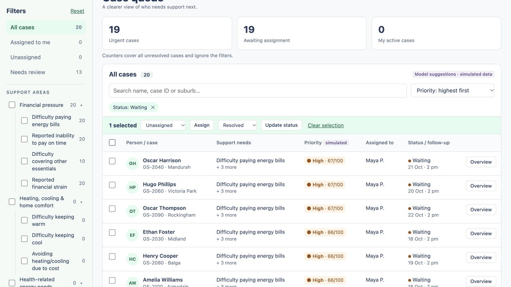

# Workflow audit — 16 October 2026

Audit branch: `debug`. Inspected application commit: `0a4eaf33e88745d9dc0ab5801ebec2bda02795d1`.
Started at 19:20 Australia/Perth. Focus: manager assignment → worker casework → review/status/notes → conflict recovery and Undo. Findings were reproduced before filing. This branch contains audit evidence and reproduction support; application behavior has not been changed.

## Findings and recommended fix order

| Priority | Issue | Confirmed failure |
| --- | --- | --- |
| P1 | [#2 — late overview response changes active case](https://github.com/Chit-Thway/greenspark-ervei/issues/2) | Open A then B while A's response is delayed: B's panel is replaced by A. Actions use the resulting active case. Guard overview requests and invalidate them on navigation. |
| P1 | [#5 — hidden selections remain actionable after filtering](https://github.com/Chit-Thway/greenspark-ervei/issues/5) | New filtered rows load while the separate selection-pruning request is pending. Update status can resolve an excluded case. Block bulk actions until selection validity is known. |
| P2 | [#4 — assignment conflict retries never recover](https://github.com/Chit-Thway/greenspark-ervei/issues/4) | Keep a case open while paging away, then make a concurrent edit. Save assignment repeatedly sends the stale version despite claiming that the latest version was loaded. Update the open overview from the conflict fetch. |
| P2 | [#8 — old worker panel remains editable after reassignment](https://github.com/Chit-Thway/greenspark-ervei/issues/8) | After a manager reassigns a case, the old worker's forbidden save refreshes the list but leaves the overview's old assignee and enabled controls. Refresh the open case and recompute edit permissions. Server permission enforcement is intact. |
| P2 | [#3 — obsolete follow-up returns on reopening](https://github.com/Chit-Thway/greenspark-ervei/issues/3) | Resolve an active case with a follow-up, then reopen it. Its old date returns, contrary to the workflow contract's Not scheduled behavior. Distinguish a normal reopen from Undo of resolution. |
| P2 | [#7 — UI selects more cases than the API accepts](https://github.com/Chit-Thway/greenspark-ervei/issues/7) | Create case 101, select all 13 pages, then Update status. The enabled action fails with a generic validation message because the API maximum is 100. Enforce and explain the limit before submission. |
| P3 | [#6 — worker assignment dropdown says Unassigned](https://github.com/Chit-Thway/greenspark-ervei/issues/6) | The facts section shows Alex/Sarah correctly, but the disabled assignment dropdown contains only Unassigned because assignableUserIds is empty for workers. Render the true assignee in the read-only control. |

P1 findings affect which cases staff may act on. P2 findings interrupt recovery or produce incorrect workflow state. The P3 issue is display-only. The seven issue bodies contain detailed steps, expected/actual results, commit-pinned source links, and suggested fix directions.

## Core workflow that passed

- Manager selects two unassigned cases and bulk-assigns them to Alex; table and counters update.
- Undo restores both assignments; assigning again succeeds.
- Switching to Alex and Assigned to me exposes the assigned cases.
- Alex adds a note, changes status to Waiting, and marks suggestions reviewed; server updates persist.
- A manager creates a minimal case; it starts pending, unknown, unassigned, and unscheduled. Reload and name search find it again.
- Selection survives paging (8 → 16 → … → 101); the issue is the missing limit, not selection retention.
- Worker assignment controls are disabled. A mixed-ownership bulk status request is rejected atomically. All 100 compared case versions were unchanged afterward.
- After a manager hands a case from Alex to Sarah, the server rejects Alex's further writes and Sarah can find and update the case after switching into her view.
- Existing automated tests cover single-case conflicts, bulk validation/atomicity, Undo conflicts/expiry, SQLite persistence/reset, and unavailable model results.

## Validation

- Baseline `npm test`: **45 passed** (11 shared, 1 web formatting, 33 API).
- Baseline `npm run typecheck`: passed across shared, web, API and e2e workspaces.
- New `api/test/debug-regressions.test.ts`: a fresh-database expected-failure test proves that normal reopening retains an obsolete follow-up. Both HTTP status mutations succeed; the required null follow-up assertion fails. Convert `it.fails` to `it` when fixing it.
- Final rerun: **45 passed plus 1 expected failure**; all workspace type checks, proxy JavaScript syntax check, and Git whitespace checks passed.
- Browser checks used the real application through the computer-use browser tools. The pre-existing Playwright e2e suite was inspected but was **not executed in this audit**; the browser coverage above was driven directly.
- Delays were injected only for the two confirmed race reproductions. Conflict recovery, the 101-case limit, reassignment, and ordinary workflow checks required no injected latency.
- No production sign-in, real model integration, external profile application, or live hosting was evaluated. These remain outside this workflow audit.

## Isolation and reproduction

The user app on ports 5173/3001 was preserved. Audit API port 3101 used `/private/tmp/greenspark-debug-20261016.sqlite`, seeded separately from the fixture. Audit frontends used 5273 (direct) and 5373 (latency proxy). Proxy port: 3102. Only these audit servers are stopped during cleanup; test records are confined to the disposable database.

To repeat the browser race checks, start each process in its own terminal from the repository root:

```sh
PORT=3101 GREENSPARK_DB=/private/tmp/greenspark-debug-fresh.sqlite npm run start -w api
node scripts/debug-workflow-proxy.mjs
API_URL=http://127.0.0.1:3102 npm run dev -w web -- --port 5373 --strictPort
```

Open `http://localhost:5373`. Use a new SQLite filename for a clean fixture.
The proxy reads `/private/tmp/greenspark-debug-proxy.json` for every request. To reproduce #2:

```json
{"rules":[{"method":"GET","path":"^/api/cases/GS-2011/overview$","delayMs":5000}]}
```

Open Hugo Hayes, then Isla Williams before the delayed response returns. To reproduce #5, delay the IDs endpoint instead, select a Waiting case, choose Resolved in the bulk dropdown, switch the sidebar to New, and submit while the selection is pending:

```json
{"rules":[{"method":"GET","path":"^/api/cases/ids","delayMs":8000}]}
```

Use `{"rules":[]}` to remove artificial delay. The proxy buffers and delays response delivery only; it does not change requests, API responses, or application code.

## Browser evidence

The screenshot below captures the complementary #5 reproduction: the filter and table show Waiting cases, while `1 selected` and the enabled bulk action still refer to a New case that is no longer present. In the original mutation reproduction, the API independently confirmed that an excluded Waiting case was resolved after switching the filter to New.



## Remaining work

Fix and retest P1 #2 and #5 first, then the conflict/reassignment recovery paths (#4/#8), follow-up lifecycle (#3), and bulk selection limit (#7). The ordinary sequential demo works, but the identified races should be addressed before treating concurrent casework as reliable.
