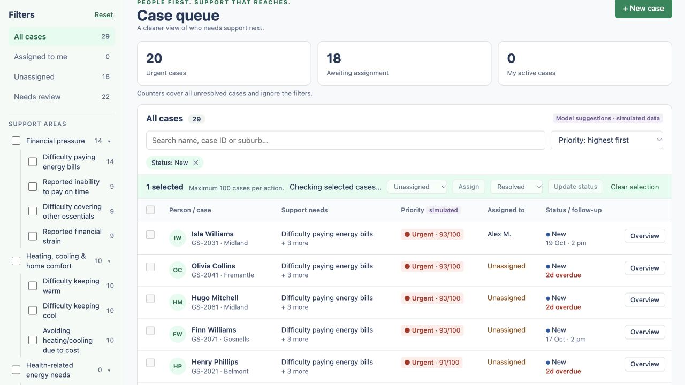
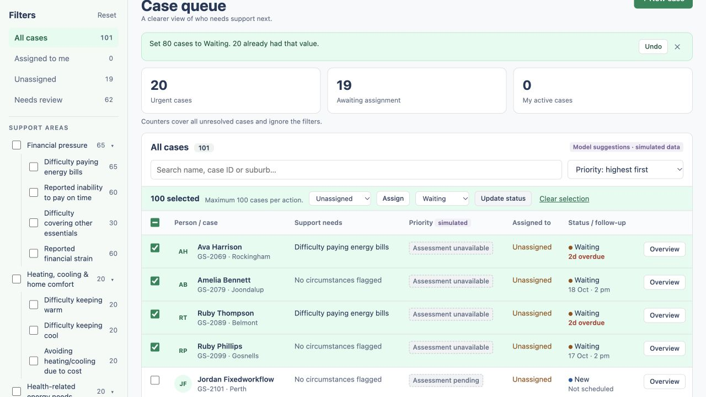

# Workflow fixes — 16 October 2026

All seven findings from the [workflow audit](2026-10-16-workflow-audit.md) are fixed on `debug`.

| Issue | Change | Verification |
| --- | --- | --- |
| [#2](https://github.com/Chit-Thway/greenspark-ervei/issues/2) | Every overview navigation has a request generation. Opening another case, closing the panel, opening New case, and unmounting invalidate older responses. Responses cannot downgrade an already newer case version. | With Hugo's response delayed by 5 seconds, opening Isla keeps Isla open after the late response. Closing stays closed. Creating Jordan while Hugo's request is pending keeps Jordan's new overview open. |
| [#5](https://github.com/Chit-Thway/greenspark-ervei/issues/5) | Bulk actions and selection controls are blocked while the table is stale, search is pending, or the selection has not been validated for the current filters/data generation. Failed validation keeps actions blocked and offers Retry selection or Clear selection. | With the IDs response delayed by 8 seconds, switching from All to New disables Assign and Update status immediately. The hidden Waiting case stays unchanged; the selection disappears after validation completes. |
| [#4](https://github.com/Chit-Thway/greenspark-ervei/issues/4) | Conflict recovery applies fetched cases to both the selection and the open overview, independently of the current table page. Unsaved assignment/status choices survive refresh for deliberate retry. | Keep Hugo open, navigate to page 2, add a concurrent manager note, then Save assignment. The current note appears, the intended assignee remains selected, and a second save succeeds. |
| [#8](https://github.com/Chit-Thway/greenspark-ervei/issues/8) | Forbidden saves reload the affected overview, including cases removed from Assigned to me. The new owner drives edit permissions. Note drafts are retained. | Reassign Alex's open case to Sarah in another session. Alex's attempted save is rejected; the overview changes to Sarah and disables review, status, and notes while retaining the draft. |
| [#3](https://github.com/Chit-Thway/greenspark-ervei/issues/3) | Resolution clears the stored follow-up; normal reopen remains unscheduled, including records resolved by older versions. Action snapshots include follow-up dates so Undo restores them. Old logs without that field still work. | Five API regressions cover normal resolution/reopen, Undo, pre-fix resolved records, bulk resolution/Undo, and legacy action logs. Browser sequence: `20 Oct · 2 pm` → resolve → no follow-up → Undo → original date → resolve/reopen → Not scheduled. |
| [#7](https://github.com/Chit-Thway/greenspark-ervei/issues/7) | UI and API share MAX_BULK_ITEMS = 100. Adding a row or page cannot exceed it. A partial final-page selection explains that remaining cases must be processed separately. Batches stay atomic. | In a 101-case queue, selections rise to 96, then cap at 100 with a clear message and an indeterminate page checkbox. Updating that batch succeeds (80 changed, 20 unchanged). Undo restores all 80 changes. Clearing and selecting the remaining case processes it successfully. Three unit regressions cover capacity, refusal of a 101st case, and existing selections at the limit. |
| [#6](https://github.com/Chit-Thway/greenspark-ervei/issues/6) | The disabled assignment select includes the actual current owner, even for workers who cannot assign. | Alex's overview displays Alex Morgan in the disabled control; after handoff it displays Sarah Chen. Manager-only assignment permissions remain in place. |

## Checks

- `npm test`: **53 passed**, with no skipped or expected-failure cases (11 shared, 4 web, 38 API).
- `npm run typecheck`: shared, web, API and e2e workspaces pass.
- `npm run build`: production build passes.
- Browser verification drove the actual React/Node application against an isolated SQLite database. It covered the ordinary manager → assignment → Undo → worker → note/status/review flow, plus every issue's reproduction above and new-case creation.
- The pre-existing Playwright e2e suite was not executed in this run; the browser checks were driven directly through the computer-use browser tools.

## Compatibility and scope

No database reset or schema migration is needed. Existing SQLite files and action logs are supported. The prediction-model and full-profile interfaces are unchanged. Test writes used `/private/tmp/greenspark-fixes-20261016.sqlite`; the user's existing demo database was preserved.

The historical audit screenshot shows the bug before the fix. These images show the new selection guard and a successful capped bulk batch:

