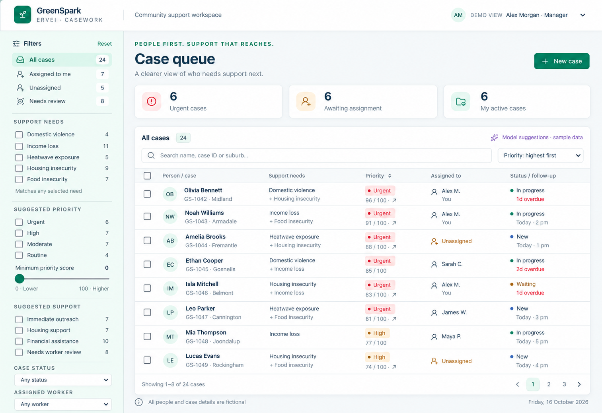
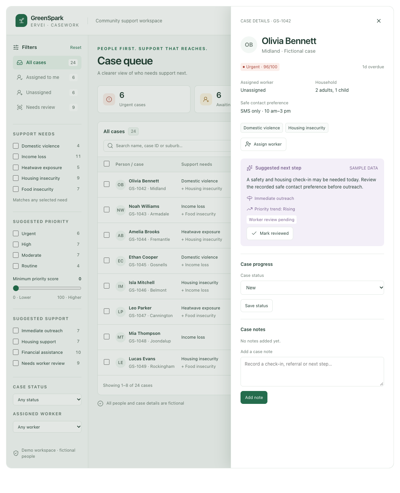

# Approved design references

Use these files together. They preserve the approved theme and workflow without requiring access to this chat or a Figma account.

## Visual and interaction references

| File | Purpose |
| --- | --- |
| [selected-green-theme.png](selected-green-theme.png) | The user-selected first theme: bright white/mint surfaces and teal-green actions. This is the color/style reference. |
| [workflow-reference.html](workflow-reference.html) | Clickable browser preview of the approved queue workflow, including filtering, role switch, assignment, bulk actions, status, notes and the right-side overview. |
| [workflow-source.fragment.html](workflow-source.fragment.html) | Original editable HTML/CSS/JavaScript reference for porting interaction and layout details into React. It is a prototype fragment, not the React application. |
| [queue-reference.png](queue-reference.png) | Static queue-layout reference. |
| [overview-reference.png](overview-reference.png) | Static right-side overview reference, including evidence/suggestion, assignment, status and notes. |
| [theme-tokens.json](theme-tokens.json) | Proposed implementation tokens that translate the selected image into explicit colors and dimensions. |

Open `workflow-reference.html` in a modern browser after cloning the repo. It embeds the prototype and its original demo data. Optional icons/tooltips use public CDN scripts; the preview does not call any customer-data service. The text controls and main interactions work independently of an external backend. The source fragment's optional `window.openai` state calls are guarded; the exported preview provides a local fallback. The React implementation must use its own state/API layer rather than depending on Codex globals.

The HTML preview can follow the browser's light/dark preference. The selected product direction for the build is the **bright light green theme**, not the prototype's automatic dark appearance.

## Which reference wins

1. [Implementation plan](../implementation-plan.md) and [data contract](../data-contract.md): current product scope, evidence semantics, taxonomy and permissions.
2. Selected green theme image and tokens: visual direction.
3. Clickable preview and overview screenshot: layout, compact drawer and interaction behavior.
4. Original architecture sketch: broad historical context only.

The images and clickable preview contain the original 24 fictional cases and older illustrative filters such as domestic violence, income loss and food insecurity. Those labels and original example counts **are superseded**. They are not source data, and should not be copied into the supported filter taxonomy or the new seed.

Build the current three support areas, nine circumstances and separate assistance/model/workflow filters from the JSON catalogs. Use the approved 100-person fixture at `data/synthetic/case-queue.v1.json` for the actual development app. Do not restore the old root-level `customers.json`.

No native Figma URL was supplied during this planning conversation. The user referred to the approved interactive prototype as the Figma workflow. These committed references are sufficient to begin; an actual Figma link can be added later if one is shared.

## Important layout details

- Keep the filter sidebar, three compact overview counters and a dominant case table.
- Open the compact overview on the right without navigating away or losing filters, sort, page or selected IDs.
- Keep the overview around 430-440 px on desktop; make it usable at narrow widths. Full individual profiles belong to the other teammate.
- Keep manager assignment, Assigned to me, row selection, page selection, bulk status/assignment and Undo feedback recognizable from the preview.
- Show 50 cases per page (the original prototype used eight; this was changed on request); totals are calculated from the new fixture and current data.
- Use readable typography, labelled controls, visible focus, text labels alongside urgency colors and keyboard-operable panels.

## Selected theme

## Compact overview

